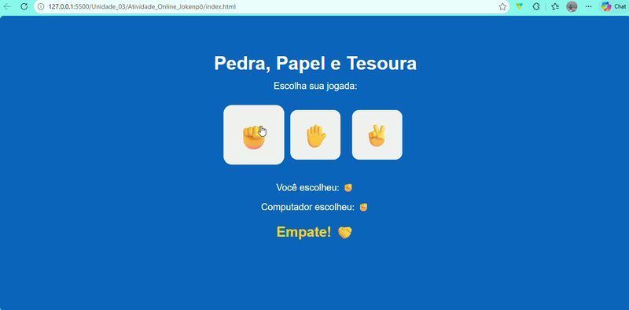

# ✊✋✌️ Jokenpô (Pedra, Papel e Tesoura)

Jogo clássico de **Pedra, Papel e Tesoura** desenvolvido para web com **HTML5**, **CSS3** e **JavaScript puro (Vanilla JS)**. O usuário escolhe uma das três opções e enfrenta o computador em tempo real, com exibição instantânea das jogadas e do vencedor da rodada.

---

## 🎬 Demonstração do Projeto 



---


## 🎯 Funcionalidades

- **Interação em tempo real:** Escolha entre Pedra (✊), Papel (✋) ou Tesoura (✌️) com um clique.
- **Jogada aleatória da máquina:** O computador sorteia uma opção diferente a cada rodada.
- **Verificação automática de resultado:** Identifica e exibe na tela se houve **empate**, **vitória do jogador** ou **vitória do computador**.
- **Feedback visual:** Efeito de ampliação nos botões ao passar o mouse e destaque em cor contrastante para o resultado da partida.

---

## 🛠️ Tecnologias Utilizadas

- **HTML5:** Estrutura semântica da página e botões de ação.
- **CSS3:** Estilização, paleta de cores, tipografia e animações suaves com `transition` e `transform: scale()`.
- **JavaScript (ES6+):** Manipulação do DOM (`querySelectorAll`, `innerHTML`), eventos de clique (`addEventListener`), arrays, geração de números aleatórios (`Math.random` / `Math.floor`) e lógica condicional.

---

## 📂 Estrutura de Arquivos

```text
Jokenpo_JavaScript/
└── Atividade_Online_Jokenpo/
    ├── ASSETS/
    │   └─ demonstracao.mp4
    │   └   demonstracao.gif
    ├── index.html
    ├── style.css
    └── script.js
```

---

## 🚀 Como executar o projeto

1. Clone este repositório para o seu computador:
   ```bash
   git clone https://github.com
   ```
2. Acesse a pasta do projeto e abra o arquivo `index.html` diretamente no seu navegador de preferência (ou utilize a extensão **Live Server** no VS Code).

---

## 👨‍💻 Autor

Desenvolvido por **sergio-santosjr**  
🔗 [GitHub]( https://github.com/sergio-santosjr/Jokenpo_JavaScript.git )